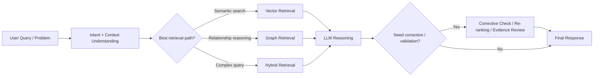
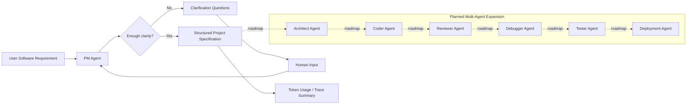
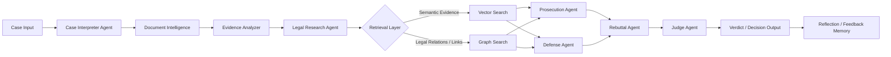
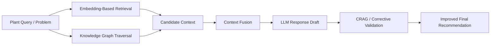

<!-- GitHub Profile README • GovindGoel1401 -->
<!-- Keep this file named README.md in the public repository GovindGoel1401/GovindGoel1401 -->

 

 
 

---

## 👋 About Me

I’m **Govind Goel**, an **AI / GenAI Engineer** focused on building systems that go beyond a simple prompt-response loop. I’m especially interested in **retrieval quality, knowledge grounding, agent orchestration, workflow routing, memory, and backend integration**.

My work sits at the intersection of **LLMs + multi-agent systems + RAG/GraphRAG + APIs + data systems**. I enjoy designing AI flows that are not only intelligent, but also **structured, explainable, and useful in real-world applications**.

<table>
<tr>
<td width="50%" valign="top">

### 🔭 Current Focus
- Agentic AI workflows using **LangGraph**
- **RAG / GraphRAG / CRAG** system design
- Multi-stage retrieval and validation pipelines
- Reliable AI backends with **FastAPI**

</td>
<td width="50%" valign="top">

### ⚡ Quick Snapshot
- 🎓 **B.Tech** · KIET Group of Institutions
- 💼 **Backend & AI Intern** · Techsage
- 🏅 **GATE Qualified** · 2026
- ☁️ AWS Certified: **Cloud Practitioner** + **AI Practitioner**

</td>
</tr>
</table>

---

## 🧠 What I Actually Like Building

| Area | What I work on |
|:--|:--|
| **🤖 Agentic AI** | Multi-agent workflows, conditional routing, task decomposition, human-in-the-loop loops |
| **🔎 Grounded Generation** | RAG, GraphRAG, corrective retrieval, document-aware response systems |
| **🕸️ Knowledge Intelligence** | Neo4j-based knowledge graphs, graph traversal, hybrid search, context assembly |
| **⚙️ AI Backend Engineering** | FastAPI services, API integration, pipeline orchestration, data flow and reliability |
| **📌 System Thinking** | Memory handling, routing logic, validation, trade-offs between latency and accuracy |

---

## 🏗️ System Thinking

These are the kinds of questions I naturally think about while building AI systems:

- How should retrieval be routed — **vector search, graph search, or both**?
- When should an agent **ask for clarification** instead of hallucinating an answer?
- How do we keep outputs **grounded, explainable, and efficient**?
- What kind of **memory** should persist across steps — temporary context, feedback memory, or graph state?
- Where should validation happen — **before generation, during reasoning, or after response drafting**?

---

## 🚀 Featured Projects

## 01 · 🤖 Autonomous GenAI Software Engineering System

**Goal:** Build an autonomous multi-agent software engineering workflow that can take a natural language requirement and gradually move it toward structured planning, development, testing, and deployment.

**Tech:** `LangGraph` `Gemini API` `Node.js` `JavaScript` `State Checkpointing`

### Why this project stands out
- Moves beyond a single chatbot into a **role-based AI workflow**.
- Uses **human-in-the-loop clarification** instead of blindly assuming requirements.
- Treats software development as a **stateful graph of decisions**, not just a one-shot prompt.

### Current architecture view

### What’s already implemented
- **PM Agent** for converting rough requirements into structured specifications.
- **Conditional routing** for clarification vs final specification generation.
- **Checkpoint/state support** for flow continuity.
- **Usage visibility** through Gemini token tracking.

> **Important:** The repository currently demonstrates the **Phase 1 PM-agent workflow**. The broader autonomous engineering team is the **vision and roadmap**, not something I’m falsely claiming as fully finished.

---

## 02 · ⚖️ JurisMind AI — Legal Reasoning & Decision Intelligence

**Goal:** Create a legal intelligence system that can process case information, retrieve relevant legal context, reason from multiple perspectives, and generate structured verdict-style outputs.

**Tech:** `LangGraph` `FastAPI` `LLM APIs` `GraphRAG` `Vector Retrieval` `Neo4j` `Pinecone / Chroma / FAISS`

### High-level flow

### Core design thinking
- Different reasoning roles improve **structured analysis** instead of a flat answer.
- Hybrid retrieval helps combine **semantic similarity** with **relationship-aware legal context**.
- Reflection/feedback memory creates a foundation for **iterative improvement**.

### Project highlights
- Designed **multi-agent legal reasoning pipelines**.
- Incorporated **dynamic retrieval routing** for more efficient query processing.
- Focused on **factual grounding, contradiction handling, and context-aware outputs**.

---

## 03 · 🌿 Deepleaf — GraphRAG-Based AI Plant Intelligence System

**Goal:** Combine semantic retrieval and graph reasoning to deliver more intelligent and reliable plant-related recommendations and responses.

**Tech:** `GraphRAG` `CRAG` `Neo4j` `Knowledge Graphs` `Vector Databases`

### Why this is interesting
- Uses **graph structure** to capture relationships that pure vector search can miss.
- Adds a **corrective validation step** to reduce hallucinations.
- The project work, as reflected in my resume, reported **~20–25% improvement in reliability**.

---

## 04 · ☁️ IBM Cloud Object Storage Q&A Assistant

**Goal:** Build a document-aware Q&A workflow where files stored in IBM Cloud Object Storage can be used securely for contextual question answering.

**Tech:** `IBM Cloud` `Cloud Object Storage` `IAM` `watsonx`

### What it demonstrates
- Cloud-based file storage and retrieval for Q&A use cases.
- Context-aware chatbot interaction over stored documents.
- **IAM-based access control** and structured indexing workflows for safer data access.

---

## 🛠️ Tech Stack

### Languages & Backend

### GenAI / Orchestration

### Data / Retrieval

### Cloud & Tools

---

## 💼 Experience

### Backend and AI Intern — Techsage
`Nov 2025 – Jan 2026`

- Built and tested backend features including **API integrations, database operations, and request handling** for internal applications.
- Implemented introductory **RAG-based AI features** for document retrieval and context-based response generation.
- Gained hands-on experience bridging **backend engineering with practical AI workflows**.

---

## 🏆 Achievements & Certifications

| Category | Details |
|:--|:--|
| **GATE** | Qualified · **2026** |
| **AWS Certifications** | **AWS Certified Cloud Practitioner** · **AWS Certified AI Practitioner** |
| **Recognition** | **Top Performer — IBM Cloud Virtual Internship** |
| **Learning** | **Data Structures & Algorithms — Udemy** |

---

## 📊 GitHub Analytics

 

---

## 🎯 Current Direction

- Building stronger intuition around **agent orchestration** and **stateful AI workflows**.
- Going deeper into **retrieval architecture** — vector search, graph search, hybrid strategies, and validation.
- Exploring how to make AI systems more **grounded, reliable, and explainable**.
- Improving at the intersection of **backend systems + AI product engineering**.

---

## 🤝 Let’s Connect

I’m always interested in **AI engineering**, **GenAI system design**, **RAG/GraphRAG**, and **multi-agent workflow** discussions.

<!--
Optional upgrades later:
1. Add your LinkedIn URL once available.
2. Replace project headings with exact repo links for JurisMind, Deepleaf, and IBM Cloud project if those repos are public.
3. Add a small hero gif or architecture image if you create one later.
-->
