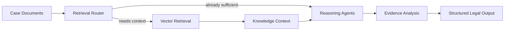
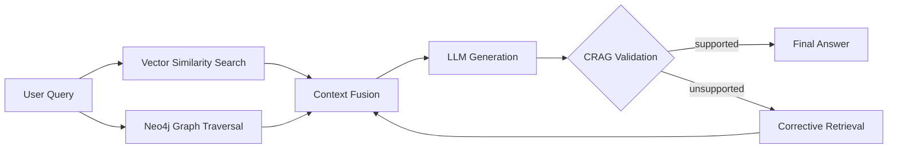
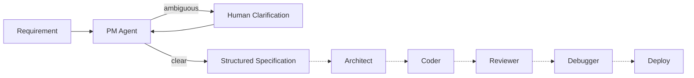

# Govind Goel

### AI / GenAI Engineer · Multi-Agent Systems · RAG & GraphRAG · Backend

*I build LLM systems that show their evidence, verify their answers, and ship behind real APIs.*

 

**[Projects](#-featured-projects) · [Skills](#%EF%B8%8F-tech-stack) · [Experience](#-experience) · [Contact](#-lets-build-something-reliable)**

---

## ⚡ At a Glance

| | |
|---|---|
| 🧠 **What I do** | Design retrieval pipelines, multi-agent workflows, and backend APIs that make LLM output trustworthy |
| 🔬 **Core ideas** | Hybrid vector + graph retrieval · corrective RAG · human-in-the-loop agents · stateful, resumable workflows |
| 🎓 **Education** | B.Tech, KIET Group of Institutions · CGPA **8.3 / 10** (2023 – Present) |
| 🏅 **Credentials** | GATE 2026 Qualified · AWS Certified Cloud Practitioner · AWS Certified AI Practitioner |
| 💼 **Experience** | Backend & AI Intern @ Techsage (Nov 2025 – Jan 2026) |
| 🔭 **Exploring** | Autonomous software-engineering agents · evaluation of GraphRAG/CRAG · AI observability |

> **My thesis:** an LLM answer is only as useful as the evidence behind it. I focus on the layer around the model: retrieval that finds the right context, agents that know when to ask, verify, and correct, and backend services that turn it all into a product.

---

## 🚀 Featured Projects

### ⚖️ JurisMind AI: Legal Reasoning & Decision Intelligence

> A multi-agent platform for legal document understanding, evidence analysis, research, and structured argumentation.

**Stack:** `Python` `FastAPI` `LangGraph` `LLM APIs` `Vector Databases`

- **Orchestrated** specialized reasoning agents (case interpretation, evidence analysis, response assembly) with **LangGraph**.
- **Dynamic retrieval routing** skips unnecessary retrieval steps to cut redundant processing.
- **Grounded outputs** by combining vector search with structured knowledge context.

---

### 🌿 Deepleaf: GraphRAG Plant Intelligence System

> Semantic retrieval plus knowledge-graph reasoning for precise, explainable plant recommendations.

**Stack:** `GraphRAG` `CRAG` `Neo4j` `Vector Databases` `Knowledge Graphs`

- **Hybrid retrieval:** embeddings for semantic match, graph relationships for entity-level reasoning.
- **Corrective RAG (CRAG)** validates and repairs answers to reduce unsupported claims.
- 📈 **~20–25% improvement in response reliability** over the baseline pipeline.

---

### 🤖 Autonomous GenAI Software Engineering System

> A multi-agent system that turns natural-language requirements into engineering specifications, built to grow into a full idea-to-deployment pipeline.

**Stack:** `Node.js` `LangGraph` `Gemini API` `JavaScript` `State Checkpointing` `Redis`

Solid lines: implemented (Phase 1). Dotted lines: roadmap.

- **Human-in-the-loop routing:** the graph asks clarifying questions before committing to a spec.
- **Resumable execution** via checkpointing (in-memory or Redis) so interrupted runs can continue.
- **Cost awareness** through Gemini token-usage tracking.
- **Clean architecture:** agents communicate through shared graph state, not direct node-to-node calls.
- **Tested:** graph-skeleton mock tests plus PM-Agent integration tests.

---

### ☁️ IBM Cloud Object Storage Q&A Assistant

> Cloud-backed file storage with a conversational assistant for asking questions about stored documents.

**Stack:** `IBM Cloud` `Cloud Object Storage` `IBM watsonx` `IAM`

- Uploads and manages files in **IBM Cloud Object Storage** with a structured indexing workflow for discovery.
- **watsonx chatbot** answers context-aware questions about stored files.
- **IAM-based access control** protects cloud resources.
- 🏆 Recognized as **Top Performer** in the IBM Cloud Virtual Internship.

---

## 🛠️ Tech Stack

### Languages

### AI, LLMs & Agentic Systems

### Backend & APIs

### Data, Search & Knowledge Graphs

### Cloud & Developer Tools

---

## 💼 Experience

### Backend & AI Intern · Techsage
`Nov 2025 – Jan 2026`

- Built and tested backend features covering **API integration, database operations, and HTTP request handling** for internal applications.
- Implemented **RAG-based features** (document retrieval and context-aware response generation), bridging backend services with working AI functionality.

---

## 🏆 Achievements & Certifications

| | |
|---|---|
| 🎯 **GATE 2026** | Qualified |
| ☁️ **AWS Certified Cloud Practitioner** | Cloud fundamentals |
| 🤖 **AWS Certified AI Practitioner** | AI/ML and GenAI on AWS |
| 🌟 **IBM Cloud Virtual Internship** | Top Performer |
| 📘 **Data Structures & Algorithms** | Udemy |

---

## 🎓 Education

**KIET Group of Institutions**: B.Tech · `2023 – Present` · CGPA **8.3 / 10**
**Dehradun Public School**: Higher Secondary · `2022 – 2023` · **88.2%**

---

## 🧭 What I'm Working Toward

- 🔄 Taking the **Autonomous Software Engineering** system beyond Phase 1: Architect, Coder, Reviewer, Debugger, and Deploy agents.
- 📏 Building better **evaluation methods for GraphRAG / CRAG** pipelines.
- 🤝 Deepening **multi-agent orchestration** and human-in-the-loop design.
- 📡 Improving AI application **scalability, observability, and backend reliability**.

---

## 📊 GitHub Stats

 

---

## 🤝 Let's Build Something Reliable

*Open to collaborating on AI engineering, retrieval systems, agentic workflows, and backend applications.*

