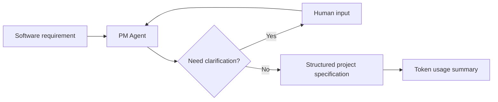

<!-- GitHub Profile README • GovindGoel1401 -->
<!-- Keep this file named README.md in the public repository GovindGoel1401/GovindGoel1401. -->

 

 
 

---

## 👨‍💻 The engineer behind the prompts

I'm **Govind Goel**, an **AI / GenAI Engineer** interested in what happens *after* an LLM generates its first answer: **retrieval quality, reasoning workflows, validation, context management, and reliable backend integration**.

I build and explore systems that combine **LLMs + agents + knowledge graphs + vector databases** to solve practical problems, from legal research and plant intelligence to cloud-based document Q&A and autonomous software-engineering workflows.

<table>
<tr>
<td width="50%" valign="top">

**🔭 What I'm working on**

- Agentic software-development workflows
- RAG, GraphRAG & corrective retrieval
- Human-in-the-loop AI orchestration

</td>
<td width="50%" valign="top">

**⚡ Quick facts**

- 🎓 B.Tech · KIET Group of Institutions
- 💼 Former Backend & AI Intern · Techsage
- 🏅 GATE Qualified · 2026
- ☁️ AWS Cloud + AI Practitioner certified

</td>
</tr>
</table>

## 🧠 What I love engineering

| Area | What I focus on |
|:--|:--|
| 🤖 **Agentic AI** | LangGraph workflows, agent coordination, conditional routing, human-in-the-loop decisions |
| 🔎 **Grounded generation** | RAG, GraphRAG, CRAG, hybrid retrieval and knowledge-backed responses |
| 🕸️ **Knowledge intelligence** | Neo4j relationships, vector similarity search, multi-stage context assembly |
| ⚙️ **Backend engineering** | Python, FastAPI, APIs, data handling, and AI service integration |

---

## 🚀 Featured Projects

### 01 · 🤖 Autonomous GenAI Software Engineering System

**The idea:** Convert natural-language software requirements into structured engineering specifications as the first step toward a collaborative AI development team.

`LangGraph` `Gemini API` `Node.js` `JavaScript` `State Checkpointing`

**What's implemented / documented in Phase 1**

- **PM Agent:** turns a requirement into a structured project specification.
- **Human-in-the-loop:** asks clarifying questions instead of making silent assumptions.
- **Stateful graph:** conditional routing and checkpointing via memory or optional Redis.
- **Testing & visibility:** graph mock tests, PM-agent test commands, and Gemini token tracking.

> **Roadmap, not a finished claim:** Architect, planner, coder, reviewer, debugger, deployment, and full dashboard phases are described as future work in the repository.

---

### 02 · ⚖️ JurisMind AI — Legal Reasoning & Decision Intelligence

**Multi-agent legal intelligence** for document understanding, evidence analysis, research, and structured reasoning.

`LangGraph` `FastAPI` `LLM APIs` `Vector Databases` `Hybrid Retrieval`

- Designed **multi-agent workflows** with dynamic retrieval routing to avoid unnecessary processing.
- Combined **vector-based search and knowledge-based context** for better grounding.
- Focused on **context-aware outputs, workflow efficiency, and layered legal reasoning**.

### 03 · 🌿 Deepleaf — GraphRAG Plant Intelligence

**Knowledge-driven plant intelligence** combining graph relationships with semantic retrieval.

`Neo4j` `GraphRAG` `CRAG` `Vector Databases` `Knowledge Graphs`

- Built multi-stage retrieval combining **embedding similarity** with **graph traversal**.
- Added **corrective retrieval / validation** to challenge unsupported model answers.
- The project results reported in my resume indicate a **20–25% reliability improvement**.

### 04 · ☁️ IBM Cloud Object Storage Q&A Assistant

**Cloud-backed document Q&A** connecting object storage with contextual chatbot interactions.

`IBM Cloud` `Cloud Object Storage` `IBM watsonx` `IAM`

- Stored and accessed files through **IBM Cloud Object Storage**.
- Integrated an **IBM watsonx chatbot** for context-aware document questions.
- Used **IAM-based access controls** and structured file-indexing workflows.

> 💡 **Project-first portfolio:** I value clear architectures, useful retrieval, and systems that can explain where their answers come from.

---

## 🛠️ Tech Stack

**Languages & APIs**

**GenAI & Orchestration**

**Data & Retrieval**

**Cloud & Tools**

---

## 💼 Experience

**Backend & AI Intern — Techsage**  
`Nov 2025 – Jan 2026`

- Built and tested backend functionality including **API integrations, database operations, and request handling**.
- Implemented introductory **RAG-based features** involving document retrieval and context-based response generation.

## 🏆 Achievements & Certifications

| Credential | Detail |
|:--|:--|
| 🎯 **GATE** | Qualified · 2026 |
| ☁️ **AWS** | Certified Cloud Practitioner |
| 🤖 **AWS** | Certified AI Practitioner |
| 🌟 **IBM Cloud** | Virtual Internship · Top Performer |
| 📚 **DSA** | Udemy certification |

**Education:** B.Tech, **KIET Group of Institutions** (2023–Present) · **CGPA 8.3/10**

---

## 📊 GitHub Activity

 

---

### ✨ Build intelligence. Ground answers. Ship thoughtfully.

**Interested in AI engineering, agentic workflows, knowledge graphs, and practical backend systems?**

 

Made with curiosity, code, and a healthy respect for evaluation. ✦

